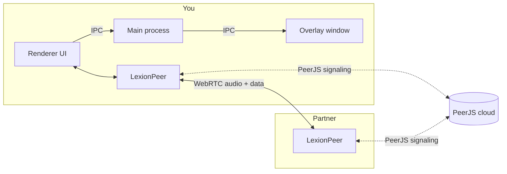

<div align="center">
  

  # Lexion

  **A private peer-to-peer voice line and chat, always one click away.**

  [](https://www.electronjs.org)
  [](https://react.dev)
  [](https://peerjs.com)
  [](LICENSE)
</div>

---

Lexion is a small desktop app for talking to exactly one person. It opens a direct WebRTC
connection between two peers using usernames as addresses, then gets out of the way behind a
transparent, always-on-top orb.

No sign-up. No Lexion server. No message history. Just a username, a partner, and a voice line.

## Features

- **Peer-to-peer voice** — microphone audio is sent straight to your partner over WebRTC.
- **Peer-to-peer chat** — messages travel over a PeerJS data connection.
- **Floating orb overlay** — stays above other windows, snaps to screen edges, and tucks away
  when you drag it off-screen.
- **Push-to-talk** — hold the orb or use a global hotkey, even when the orb is hidden.
- **Speaker detection** — the orb glows while your partner is talking.
- **Message previews** — incoming messages appear next to the orb for a configurable duration.
- **Audio device picker** — choose input/output devices and test your microphone with a live
  waveform, meter, and recorded playback.
- **Remappable global shortcuts** — bind any key or key combination for push-to-talk and
  show/hide.
- **System tray + background mode** — closing the window keeps Lexion running in the tray.
- **Local-first settings** — profile and preferences are plain JSON files on your machine.
- **Multi-monitor aware overlay** — the transparent overlay covers the full virtual desktop and
  follows display changes.

## How it works



- The **main process** owns windows, the tray, global shortcuts, the app menu, and JSON storage.
- The **renderer** owns the React UI and the `LexionPeer` WebRTC client.
- The **overlay renderer** draws the orb and chat panel. The main process performs hit-testing so
  clicks pass through transparent areas.
- **PeerJS** is used only for signaling. Audio and chat are peer-to-peer; a TURN relay is used when
  a direct route is blocked by NAT or a firewall.

More detail: [`docs/ARCHITECTURE.md`](docs/ARCHITECTURE.md).

## Requirements

- **Node.js 20.19+** and npm 10+
- Windows 10/11, macOS, or a modern Linux desktop
- A microphone and speakers/headphones
- An internet connection for signaling (and for the TURN relay when a direct connection fails)

## Quick start

```bash
git clone <your-fork-url> lexion
cd lexion
npm install
npm run dev
```

The first launch walks through onboarding, then the orb appears in the bottom-right corner.

> **Note:** if your machine is behind a restrictive proxy and Electron’s binary download fails,
> reinstall with `npm install electron --force`, or set `ELECTRON_MIRROR` to a reachable mirror.

## Scripts

| Script | What it does |
| --- | --- |
| `npm run dev` | Start Electron with hot reload (electron-vite) |
| `npm run dev:second` | Start a second isolated instance (`--profile=second`) for local testing |
| `npm run build` | Build main, preload, and both renderer pages into `out/` |
| `npm start` | Preview the production build |
| `npm run dist` | Build and package for the current platform with electron-builder |
| `npm run dist:dir` | Build an unpacked app directory (fast smoke test) |
| `npm run dist:win` | Build a Windows NSIS installer |
| `npm run dist:mac` | Build a macOS DMG |
| `npm run dist:linux` | Build a Linux AppImage |

Artifacts are written to `release/`.

## First run

1. Enter a display name and a unique username (your **Peer ID**).
2. Open **Settings** and enter your partner’s username.
3. Both people need Lexion open at the same time with different usernames.
4. Click **Save & Connect**, then use the orb:
   - **Click** — open/close chat
   - **Hold** — push to talk
   - **Double-click** — toggle the microphone
   - **Right-drag** — move the orb; release near an edge to tuck it away
   - **Left-click a tucked orb** — bring it back

## Configuration

Settings are stored under the Electron `userData` directory:

| Platform | Location |
| --- | --- |
| Windows | `%APPDATA%\lexion\.appdata\` |
| macOS | `~/Library/Application Support/lexion/.appdata/` |
| Linux | `~/.config/lexion/.appdata/` |

| File | Purpose |
| --- | --- |
| `user.json` | Display name and username |
| `connect.json` | Peer IDs, partner, hotkeys, audio devices, toast duration |

Run a second isolated copy for testing with `--profile=name` (`npm run dev:second` uses
`--profile=second`); it reads and writes `lexion-name/.appdata` instead.

### `connect.json` fields

| Field | Type | Meaning |
| --- | --- | --- |
| `username` | string | Your Peer ID (lowercase letters, numbers, `_`, `-`) |
| `partner` | string | The Peer ID Lexion calls on startup |
| `toastDurationSec` | number | Message preview duration, 1–60 seconds |
| `pttKey` / `pttLabel` | string | Push-to-talk accelerator and display label |
| `overlayToggleKey` / `overlayToggleLabel` | string | Show/hide accelerator and label |
| `audioInputId` / `audioOutputId` | string | Selected microphone and speaker device IDs |

## Keyboard and orb controls

| Action | Control |
| --- | --- |
| Open chat | Left-click the orb |
| Push to talk | Hold the orb, or the configured global hotkey |
| Toggle microphone | Double-click the orb |
| Move the orb | Right-drag |
| Show/hide the orb | Tray menu, Settings button, or global hotkey |
| Close chat | `Esc` or the ✕ button |

## Project structure

```
lexion/
├── build/                     # Packaging resources (icon)
├── docs/                      # Architecture and maintenance notes
├── src/
│   ├── main/
│   │   ├── index.js           # App lifecycle, menus, tray, IPC, JSON storage
│   │   ├── hotkeys.js         # Global shortcut registration
│   │   └── overlays/          # Transparent overlay window + hit-testing
│   ├── preload/index.js       # contextBridge APIs (api, overlay, lexion)
│   └── renderer/
│       ├── index.html         # Main window entry
│       ├── overlay.html       # Overlay window entry
│       ├── assets/            # Orb artwork
│       └── src/
│           ├── home/          # Shell navigation + placeholder dashboard
│           ├── onboarding/    # First-run flow
│           ├── settings/      # Connection settings
│           ├── preferences/   # Audio devices + keybindings
│           ├── profile/       # Display name / username
│           ├── lexion_core/   # Peer client, orb, chat, overlay styles
│           ├── styles/        # Design tokens + global styles
│           └── utils/         # Peer ID sanitizer, key binding builder
├── electron.vite.config.mjs
└── package.json
```

## Troubleshooting

| Problem | Fix |
| --- | --- |
| **Username already taken** | Another running instance (or another person) is using that Peer ID. Quit duplicate instances or pick a new username. |
| **Partner not found** | Check the username spelling; both apps must be open at the same time. |
| **Connecting forever / ICE failed** | Try the same Wi-Fi, disable a VPN, or allow WebRTC traffic through your firewall. |
| **No microphone** | Allow microphone access, then test it under **Preferences → Audio Devices**. |
| **No sound** | Choose the correct speaker under Preferences and use **Record Clip → Play on Selected Output**. |
| **Hotkey does nothing** | Another app may own the shortcut. Pick another combination in Preferences. Push-to-talk is disabled while the orb is hidden. |
| **Orb is invisible** | Use the tray menu or **Settings → Toggle Floating Ball**. |
| **Window closed but app still running** | Lexion minimizes to the tray by design. Use the tray menu to quit. |

## Privacy and security

- No analytics, telemetry, or Lexion-hosted accounts.
- Chat history is kept in memory only and is cleared when the overlay restarts.
- Audio is streamed live and is never recorded by Lexion.
- Settings are unencrypted JSON on disk; protect your OS account accordingly.
- The TURN credentials in `src/renderer/src/lexion_core/peer/LexionPeer.js` are bundled demo
  credentials. Replace them with your own relay before distributing builds.

See [`SECURITY.md`](SECURITY.md) for reporting vulnerabilities.

## Contributing

Contributions are welcome. Please read [`CONTRIBUTING.md`](CONTRIBUTING.md) and the
[`CODE_OF_CONDUCT.md`](CODE_OF_CONDUCT.md) before opening a pull request.

## License

[MIT](LICENSE) © Lexion contributors
