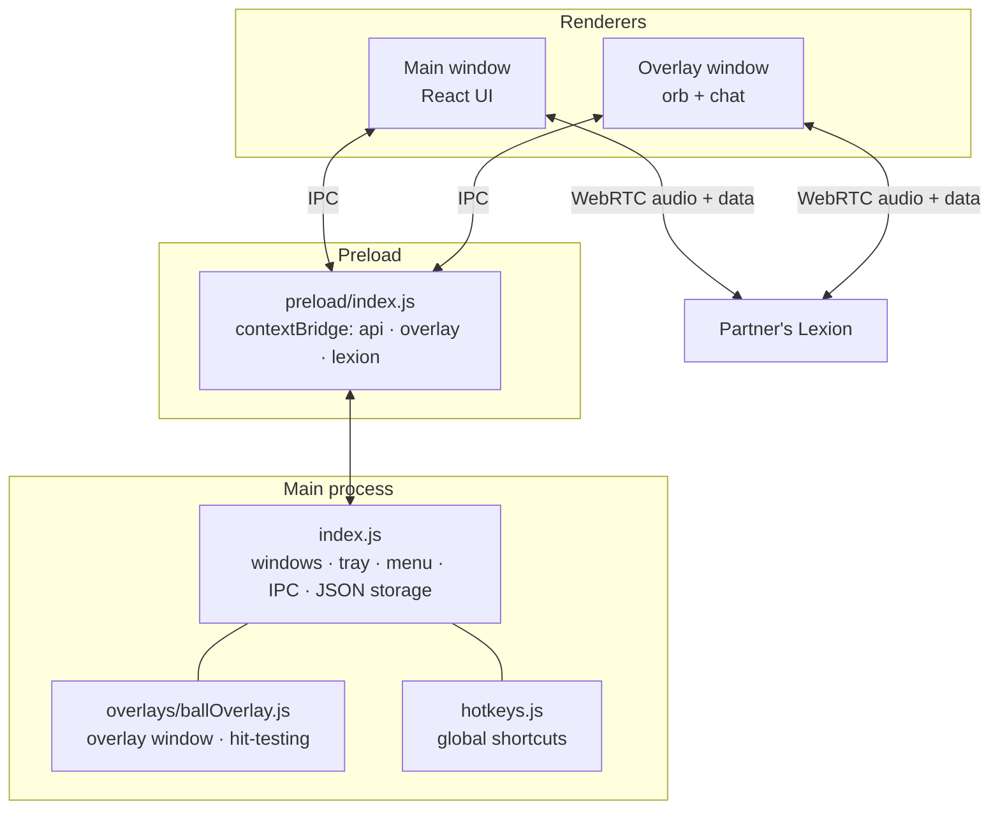

# Architecture

Lexion is a three-process Electron app: a **main process** that owns the operating-system
surface, a **preload script** that exposes a narrow API, and **two renderer windows** — the
settings window and a transparent overlay window that draws the orb and chat.

## Entry points

| File | Role |
| --- | --- |
| `src/main/index.js` | App lifecycle, single-instance lock, windows, tray, menu, JSON storage, IPC handlers |
| `src/main/overlays/ballOverlay.js` | Creates the transparent always-on-top window and forwards mouse events |
| `src/main/hotkeys.js` | Registers/unregisters global push-to-talk and show/hide shortcuts |
| `src/preload/index.js` | `contextBridge` surface shared by both renderers |
| `src/renderer/index.html` → `src/renderer/src/main.jsx` | Settings window entry |
| `src/renderer/overlay.html` → `src/renderer/src/lexion_core/overlay.jsx` | Overlay window entry |
| `electron.vite.config.mjs` | Builds main, preload, and the two renderer pages |

## Main process

### Lifecycle

1. `--profile=<name>` switches `userData` to `%APPDATA%\lexion-<name>` so a second instance can
   run locally with a different identity.
2. Without `--profile`, a single-instance lock is taken. A second launch focuses the existing
   window through the `second-instance` event.
3. On `whenReady`, the menu and tray are built, the main window is created, then the overlay is
   created and the tray is registered. Failures in tray or overlay creation are logged but do not
   stop the app.
4. Closing the main window hides it; the app stays alive in the tray. `Quit` sets `isQuitting` and
   exits.

### Storage

All persistence is plain JSON under `join(app.getPath('userData'), '.appdata')`.

| Handler | Behavior |
| --- | --- |
| `app:save-data` | Writes `basename(file)` only (path-traversal guard). Saving `connect.json` also re-applies hotkeys and pushes `lexion:apply-settings` to the overlay. |
| `app:load-data` | Reads and parses a JSON file, returning `null` on any error. |

The renderer must merge before saving: a full-object write replaces the file. `Settings.jsx` reads
the existing file and spreads it so audio devices, hotkeys, and toast duration survive a save.

### Assets

`ASSET_DIR` resolves differently in development (`src/renderer/assets`) and when packaged
(`process.resourcesPath/assets`, populated by `extraResources` in `package.json`). Tray and window
icons use `assetPath()` so packaging does not break them.

## Overlay and hit-testing

The overlay is a frameless, transparent, always-on-top `BrowserWindow` covering the **union of all
display bounds** (`getVirtualBounds()`). It is ignored for mouse input by default
(`setIgnoreMouseEvents(true, { forward: true })`).

The renderer reports interactive shapes — circles for the orb, rectangles for the chat panel — to
the main process through `overlay:set-areas`. Every 25 ms the main process:

1. Converts the global cursor position into overlay-local coordinates using `overlayBounds`.
2. Checks the point against each shape with a 10 px `HIT_PAD`.
3. Toggles `setIgnoreMouseEvents` when the answer changes.

This lets clicks pass through transparent regions while keeping the orb and chat clickable. While
the user drags the orb (`overlay:set-drag`), input is forced interactive. `overlay:force-ignore`
temporarily locks the window to click-through after a drag ends.

Display changes (`display-added`, `display-removed`, `display-metrics-changed`) recompute the
bounds and reset the mouse state.

### Orb interactions

| Gesture | Result |
| --- | --- |
| Click | Toggle chat |
| Hold (450 ms) | Push-to-talk |
| Double-click | Toggle microphone |
| Right-drag | Move the orb; releasing near an edge stashes it |
| Click while stashed | Bring the orb back |

The orb position is stored in `localStorage` inside the overlay renderer and clamped to the window
on resize.

## Hotkeys

`applyHotkeys(settings)` stores the latest `connect.json` and calls `refreshHotkeys()`.
`globalShortcut.unregisterAll()` runs first, so only one set is ever active.

- Push-to-talk is registered **only while the overlay is visible**, and sends
  `lexion:ptt-toggle` to the overlay renderer.
- The overlay toggle key is always registered and calls `toggleBallOverlay()`.

Registration failures (shortcut already owned by another app) are logged and ignored.

## Preload API

The preload exposes three frozen-in-practice namespaces. No `ipcRenderer` or Node API is exposed.

### `window.api`

| Member | Direction | Purpose |
| --- | --- | --- |
| `versions` | static | Electron, Chromium, and Node versions for the About screen |
| `saveData(file, data)` | invoke | Write a JSON file |
| `loadData(file)` | invoke | Read a JSON file |

### `window.overlay`

| Member | Direction | Purpose |
| --- | --- | --- |
| `setAreas(areas)` | send | Report interactive shapes |
| `setDrag(on)` | send | Enable/disable drag mode |
| `applyAudioDevices(inputId, outputId)` | send | Ask the overlay peer to switch devices |
| `onApplyAudioDevices(cb)` | on | Receive device changes |
| `forceIgnore()` | send | Temporarily force click-through |
| `openMain()` | send | Bring the settings window forward |
| `sendStatus(status)` | send | Publish connection/mic status to main |
| `onPttToggle(cb)` | on | Receive the global push-to-talk action |
| `onApplySettings(cb)` | on | Receive updated `connect.json` |

### `window.lexion`

| Member | Direction | Purpose |
| --- | --- | --- |
| `toggleOverlay()` | send | Show/hide the orb |
| `updateHotkeys(partial)` | send | Merge and re-register shortcuts |
| `getStatus()` | invoke | Latest overlay status |
| `onStatus(cb)` | on | Stream status updates to the settings window |

## Renderer

### Settings window

`App.jsx` loads `user.json` and chooses between onboarding and the `Home` shell. `Home` is a small
state machine over `Home`, `Profile`, `Preferences`, `Settings`, and `About`; there is no router.

| Section | Responsibility |
| --- | --- |
| `onboarding/` | Four-step first run; seeds `user.json` and a derived Peer ID in `connect.json` |
| `profile/` | Display name and username |
| `settings/` | Peer ID, partner, toast duration, overlay toggle, live status |
| `preferences/` | Audio device selection, microphone test (waveform, meter, recording), keybinding capture |
| `home/` | Navigation shell and greeting |

### Overlay window

`lexion_core/overlay.jsx` mounts `Ball` and `Chat`, owns the `LexionPeer` instance, and:

- Reports `Ball`/`Chat` geometry with `setAreas`.
- Toggles microphone state from orb gestures, the global hotkey, and chat controls.
- Sends status objects (`phase`, `connected`, `talking`, `message`) to the main process.
- Applies `connect.json` changes and audio-device changes without a restart.

### Peer connection

`lexion_core/peer/LexionPeer.js` wraps PeerJS:

- A `Peer` is created with the sanitized username as its ID.
- STUN plus Metered TURN relays are configured for NAT traversal.
- A `MediaConnection` carries microphone audio; a `DataConnection` carries chat.
- The microphone track is disabled until the user talks.

PeerJS is used for **signaling only**; audio and data are peer-to-peer (or relayed by TURN when a
direct route fails).

## Build and packaging

`electron-vite` emits `out/main`, `out/preload`, and `out/renderer` (both HTML entries plus hashed
CSS/JS and the orb image).

`electron-builder` packages from `out/` into `release/`, copies `src/renderer/assets` to
`resources/assets`, and produces:

- Windows: NSIS installer (x64)
- macOS: DMG
- Linux: AppImage

Scripts are defined in `package.json` (`dist`, `dist:win`, `dist:mac`, `dist:linux`, `dist:dir`).

## Security boundaries

- Renderers run with `contextIsolation: true` and `nodeIntegration: false`.
- File writes are restricted to `basename(file)` inside `.appdata`.
- New windows are denied; `https://` links open in the system browser.
- IPC handlers that affect the overlay check `event.sender` against the overlay's `webContents`.
- Chat history is in-memory only. Settings are unencrypted JSON.

See [SECURITY.md](../SECURITY.md) for reporting issues.
